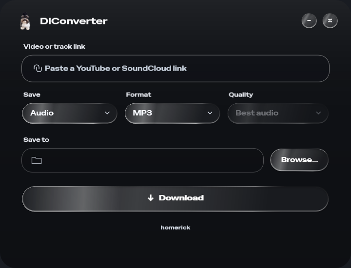

<div align="center">
  
  <h1>DIConverter</h1>
  <p><strong>Твоё видео. Твой звук. В пару кликов.</strong></p>
  <p>Компактный загрузчик YouTube и SoundCloud для Windows<br/>с тёмным стеклянным интерфейсом и размытием фона.</p>
  <p><a href="https://github.com/GeekyKrank/DIConverter/releases/latest">Скачать установщик</a> · <a href="#возможности">Возможности</a> · <a href="#сборка-из-исходников">Сборка</a></p>
  
  <p><sub>made by homerick</sub></p>
</div>

## Возможности

- **YouTube:** сохранение видео со звуком в MP4 или отдельной аудиодорожки.
- **SoundCloud:** скачивание отдельных треков.
- **Аудиоформаты:** MP3, M4A и WAV.
- **Качество видео:** 720p, 1080p и 1440p. Приложение выбирает лучшее доступное разрешение не выше указанного.
- **Удобный рабочий процесс:** папка сохранения запоминается; после успешной загрузки появляется сообщение, поле ссылки очищается и получает фокус.
- **Тёмное стекло:** живой фон рабочего стола, размытие, преломление и округлые элементы управления.
- **Свой характер:** логотип с собакой, шрифт Special Gothic Expanded One и подпись homerick.

| Что сохранить | Формат | Качество |
| --- | --- | --- |
| Видео YouTube | MP4 | до 720p / 1080p / 1440p |
| Звук YouTube или SoundCloud | MP3 / M4A / WAV | лучший доступный источник |

## Установка

1. Открой [последний релиз](https://github.com/GeekyKrank/DIConverter/releases/latest).
2. Скачай `DIConverter-Setup-1.0.0-x64.exe` и запусти его.
3. Выбери папку установки; при желании добавь ярлык на рабочий стол.
4. Открой DIConverter из меню «Пуск».

Установка выполняется для текущего пользователя. Администраторские права и отдельная установка .NET не требуются. Удаление доступно через настройки приложений Windows.

**Требования:** Windows 10 версии 2004 или новее, x64, подключение к интернету. Для стеклянного эффекта нужен рабочий Direct3D GPU; при недоступности GPU используется резервное оформление.

## Как пользоваться

Вставь ссылку → выбери **Audio** или **Video** → укажи формат и качество → выбери папку через **Browse…** → нажми **Download**.

После успешного сохранения внизу окна появится подтверждение. Ссылка очистится — можно сразу вставлять следующую. При ошибке ссылка останется в поле.

Плейлисты не поддерживаются. Доступность зависит от сервиса: приватные, удалённые, платные или ограниченные материалы могут быть недоступны. WAV не восстанавливает качество, потерянное в исходном сжатом аудио.

## Сборка из исходников

Нужны Windows x64, [.NET 10 SDK](https://dotnet.microsoft.com/download/dotnet/10.0) и интернет для первой загрузки зависимостей.

```powershell
powershell -ExecutionPolicy Bypass -File .\build.ps1
```

Готовое приложение: `DIConverterApp/DIConverter.exe`. Держи всю папку сборки вместе: в ней находятся .NET, рендерер, шейдеры, yt-dlp, FFmpeg и лицензии.

`setup.ps1` загружает yt-dlp и FFmpeg из официальных дистрибутивов, если их ещё нет в `tools/`. NuGet восстанавливает XamlTemplates.FX.Wpf. При наличии локального SDK в `tools/dotnet` скрипт использует его.

### Установщик

Установи [Inno Setup](https://jrsoftware.org/isinfo.php), затем выполни:

```powershell
powershell -ExecutionPolicy Bypass -File .\build-installer.ps1
```

При необходимости передай `-CompilerPath "C:\path\to\ISCC.exe"`. Результат находится в `dist/`.

### Проверки

```powershell
.\DIConverterApp\DIConverter.exe --self-test
.\DIConverterApp\DIConverter.exe --style-preview
.\DIConverterApp\DIConverter.exe --material-check
```

`--self-test` проверяет ссылки и загрузку XAML. `--style-preview` сохраняет превью интерфейса и проверяет, что клики по Video не перехватываются перетаскиванием окна. `--material-check` записывает диагностику GPU и изображение WPF-слоя; в него не входит нативный фон DirectComposition.

## Устройство проекта

```text
Assets/                 Логотип, иконка и шрифт с лицензией
LiquidApp/              Проект WPF, GPU-рендерер и шейдеры
DesktopGlass.cs         Окно, настройки и загрузка медиа
GlassWindow.xaml        Интерфейс и стили
MediaUrl.cs             Проверка ссылок
LiquidHighlights.cs     Световые эффекты
installer/              Сценарий установки Inno Setup
docs/                   Скриншот интерфейса
build.ps1               Сборка приложения
build-installer.ps1     Сборка установщика
setup.ps1               Загрузка внешних инструментов
```

SDK, кеши NuGet, внешние EXE и готовые сборки исключены из Git. Установщик публикуется в Releases.

## Сторонние компоненты

- [yt-dlp](https://github.com/yt-dlp/yt-dlp) — получение медиа; официальные бинарные сборки и их исходники доступны в релизах проекта.
- [FFmpeg Essentials](https://www.gyan.dev/ffmpeg/builds/) — конвертация и объединение дорожек; GPL и сведения об исходниках входят в дистрибутив. Лицензия копируется в `licenses/ffmpeg-LICENSE.txt`.
- [XamlTemplates.FX.Wpf](https://github.com/dragosniamtu/WPF-Liquid-Glass-Effect), версия `1.0.0-preview.5` — GPU-стекло; распространяется по **XamlTemplates FX Community Binary License 1.0** как встроенная часть приложения. Условия и уведомления включены в `licenses/` готовой сборки. Рендерер не публикуется отдельно в этом репозитории.
- [Special Gothic Expanded One](https://fonts.google.com/specimen/Special+Gothic+Expanded+One), Alistair McCready — шрифт под SIL Open Font License; текст лицензии находится в `Assets/Fonts/`.
- Стеклянные кнопки вдохновлены [Glass Button by Petr Knoll](https://codepen.io/Petr-Knoll/pen/QwWLZdx).

Рендерер обрабатывает фон рабочего стола локально. Само приложение не сохраняет видеозаписи экрана и не отправляет захваченный фон на сервер. Для скачивания медиа выполняются запросы к соответствующим сервисам.
